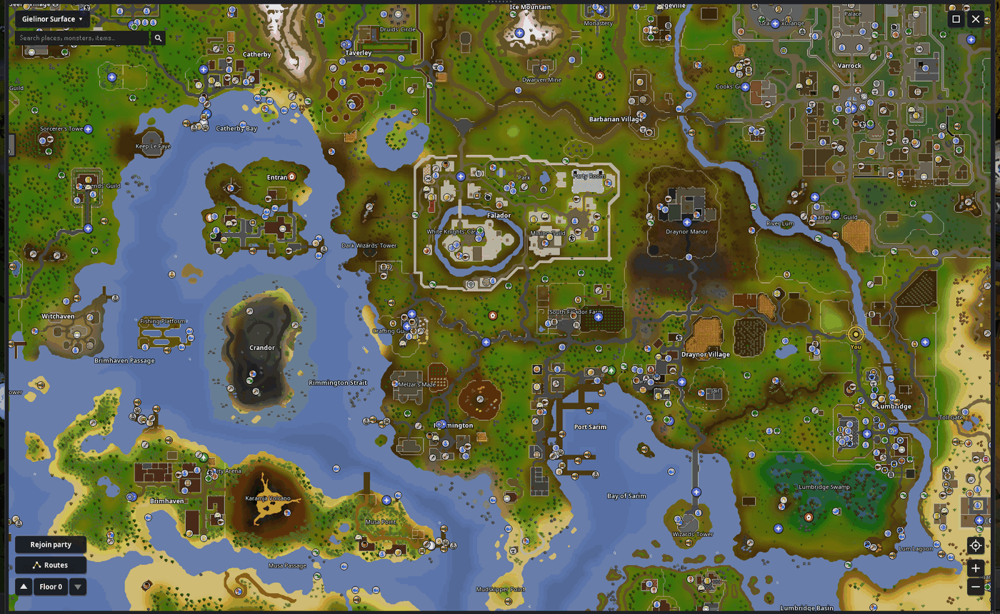
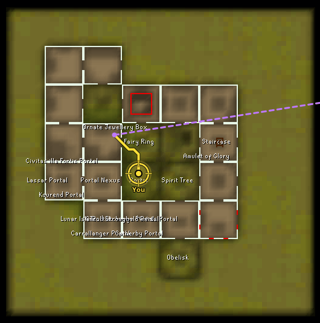
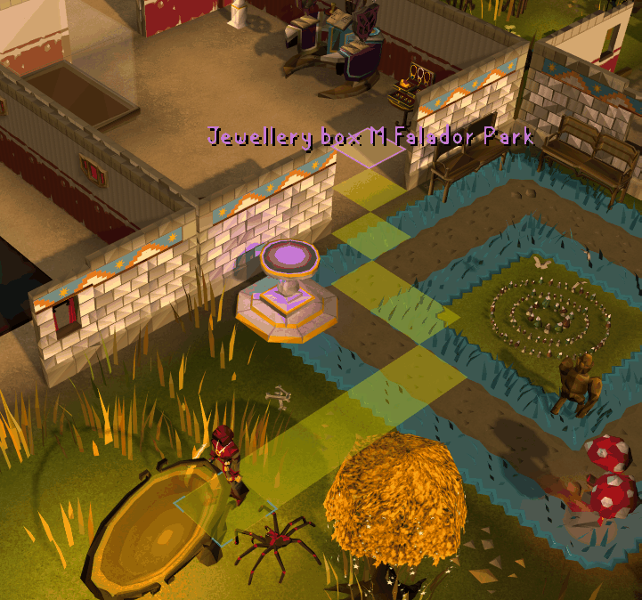
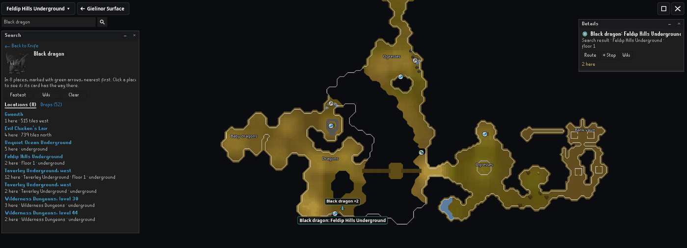

# Reimagined World Map

A world map made from the game's own map, zoomable down to the tile, with every dungeon and island. Open it from the sidebar or with M.

Click a place and the map plans the way there from where you stand, with the teleports, transport and items you have, drawn on the map, the ground and the minimap. Your own house is mapped the first time you are in it, with its portals, jewellery box, fairy ring and spirit tree, so routes go through it.

 

Search a monster, shop or item to see every place it is found, nearest first, with drops and stock, and go straight there.

The map and its data come from the plugin author's server, which sees your IP address like any website does. Nothing about you or your account is sent.

[Credits](THIRD_PARTY_NOTICES.md)
